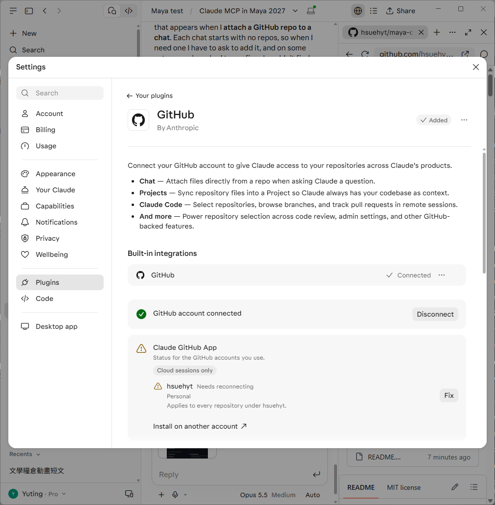
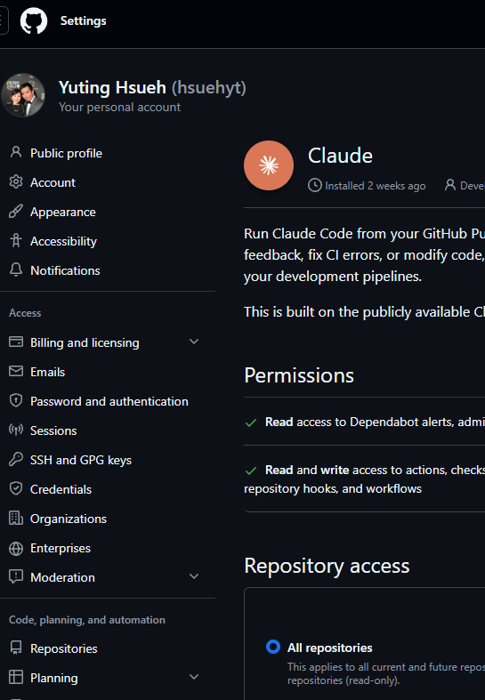
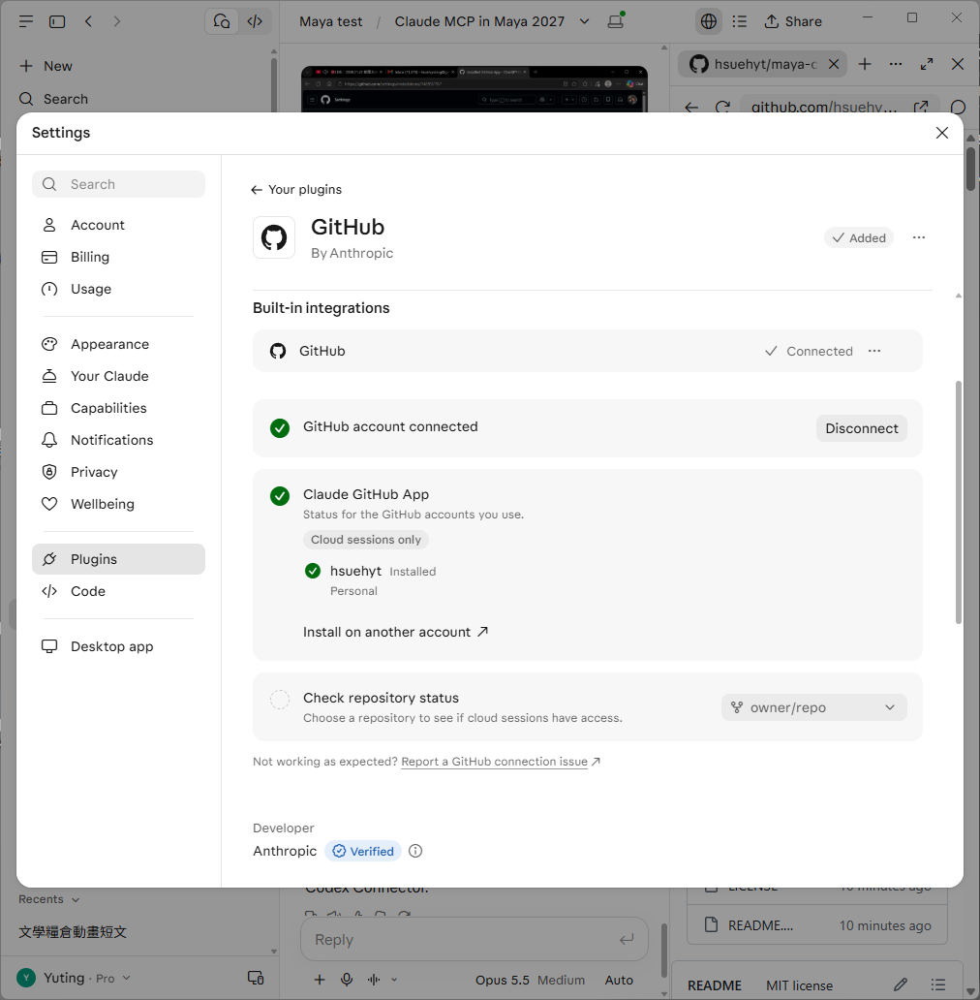
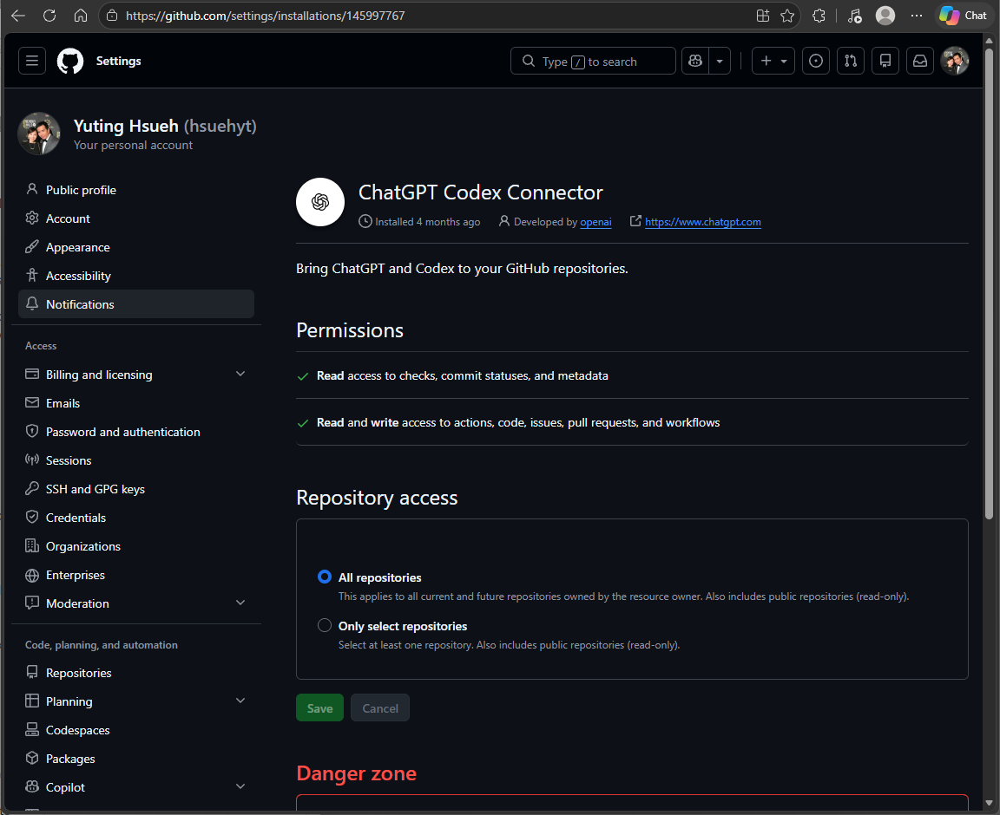

# claude-github-all-repos

A practical guide to giving **Claude** read and write access to **all of your GitHub repositories** at once, including ones you create later, so you don't have to grant access repo by repo.

When it's set up, Claude can attach your repos in a chat, clone them, commit and push in cloud sessions, and, with a signed-in browser, create new repos for you.

This repo only has documentation.

> Tested on Windows 11 with the Claude desktop app (Pro plan) and a personal GitHub account, November 2026.

---

## How it works

There are **two separate connections**, and you need both:

| Part | What it does | Where you manage it |
|---|---|---|
| **GitHub account** | Links your GitHub login to Claude, so Claude knows who you are on GitHub | Claude → **Settings → Plugins → GitHub** |
| **Claude GitHub App** | Gives Claude's **cloud sessions** permission to read and write your repos | GitHub → **Settings → Applications → Installed GitHub Apps → Claude** |

If the account is connected but the app isn't installed, or it's broken, Claude can see that you're signed in but can't reach your repos.

```
Claude (cloud session)  ──Claude GitHub App──>  your repos (All repositories)
```

---

## Step 1: Open the GitHub plugin in Claude

1. In the Claude desktop app, open **Settings** (click your name at the bottom left, then **Settings**).
2. Click **Plugins**, then **GitHub** (By Anthropic).
3. If it isn't added yet, click **Add**.

Under **Built-in integrations**, check these two boxes:

- **GitHub account connected.** If it says **Connect** instead, click it and sign in to GitHub.
- **Claude GitHub App** (Cloud sessions only). This should list your account as **Installed**.

If your account shows a ⚠️ and **Needs reconnecting**, go to Step 2.



---

## Step 2: Install or fix the Claude GitHub App with "All repositories"

1. Next to your account, click **Fix**. If the app isn't installed at all, click **Install on another account ↗**.
2. A GitHub page opens in your browser. Sign in if it asks.
3. Under **Repository access**, choose **All repositories**.

   > **All repositories** applies to all current *and future* repositories you own. New repos are included automatically, so you never have to come back here.

4. Click **Install**, or **Save** if the app was already installed.



GitHub lists the exact permissions on the same page: **read** access to things like metadata and Dependabot alerts, and **read and write** access to code, pull requests, actions, checks, workflows and similar.

You can also get here directly from GitHub: **your profile picture → Settings → Applications → Installed GitHub Apps → Claude → Configure**.

---

## Step 3: Check that it worked

Back in Claude, on **Settings → Plugins → GitHub**:

- **GitHub account connected** ✅
- **Claude GitHub App:** your account shows ✅ **Installed**



For a final check, use **Check repository status**: pick one of your repos in the **owner/repo** dropdown. It tells you whether cloud sessions can reach it.

Then start a **new chat** and ask something like:

> Clone my repo `YOUR_NAME/some-repo` and tell me what's in the README.

---

## ⚠️ Don't confuse it with ChatGPT Codex Connector

If you've used ChatGPT or Codex with GitHub before, your **Installed GitHub Apps** list may also have **ChatGPT Codex Connector** (by OpenAI). It has its own **All repositories** setting, but it has **nothing to do with Claude**. Changing it won't fix Claude's access.

The Claude app is the one called **Claude**, with the orange logo.



---

## Optional: let Claude create new repos

The GitHub App gives Claude access to repos that **already exist**. To have Claude **create** a new repo, for example "make a GitHub repo with this tutorial", it needs a browser that's signed in to your GitHub account:

- **Built-in browser** (inside the Claude desktop app). Show the browser pane with **Ctrl+Shift+B** (Windows) or **Cmd+Shift+B** (Mac), or click the globe icon, then sign in to github.com once. The sign-in stays saved for future chats. Claude never types your password, so you have to sign in yourself.
- **Claude in Chrome** (extension). This works only in **Google Chrome**. Anthropic doesn't support it in other Chromium browsers, **including Microsoft Edge**. If Edge is your browser, use the built-in browser.

After that, Claude opens `github.com/new`, creates the repo, and pushes the files through the GitHub App.

---

## Day to day

**You only do this once per GitHub account.** "All repositories" includes repos you create later, and the connection carries over to every new chat.

- **Each chat still starts with no repos attached.** Claude attaches the repo it needs when you ask. On some setups you're asked to confirm that step. That's a per-chat step, and the settings above don't remove it.
- **Organizations:** "All repositories" covers your personal account. For an organization's repos, click **Install on another account ↗**, pick the organization, and choose **All repositories** there too. You may need an organization owner to approve it.
- **Second computer:** nothing to do. The GitHub connection belongs to your Claude account, not to the computer. Only the built-in browser's GitHub sign-in is per computer.

---

## Troubleshooting

| Symptom | Fix |
|---|---|
| ⚠️ **Needs reconnecting** next to your account | Click **Fix** and approve the Claude app on GitHub (Step 2). |
| Claude says it can't access a repo | Check **Repository access** is **All repositories** on the **Claude** app (not ChatGPT Codex Connector). Then use **Check repository status**. |
| Can't find the **Fix** button | It's in the **Claude desktop app** (Settings → Plugins → GitHub), not on GitHub. |
| Claude can read repos but can't create a new one | Creating repos needs a signed-in browser. Sign in to GitHub in the built-in browser. |
| Claude in Chrome says *"Browser extension is not connected"* while you use Edge | Edge isn't supported. Use the built-in browser, or install Google Chrome. |
| An organization's repos are missing | Install the Claude app on that organization too (**Install on another account ↗**). |
| Still stuck | On the same Settings page, click **Report a GitHub connection issue ↗**. |

---

## Safety

**All repositories** with **read and write** access lets Claude change code in any of your repos, private ones included.

- Claude only works on a repo when you ask it to, but review what it pushes, especially to `main`.
- If you'd rather limit it, choose **Only select repositories** on GitHub instead and add repos one at a time.
- To revoke access completely, click **Disconnect** in Claude's GitHub plugin settings and **Uninstall** the Claude app on GitHub.

---

## Links

- Claude GitHub integration (help): <https://support.claude.com/en/articles/10167454>
- Claude connector docs, GitHub: <https://claude.com/docs/connectors/github>
- Get started with Claude in Chrome: <https://support.claude.com/en/articles/12012173>
- GitHub, reviewing installed apps: <https://github.com/settings/installations>

## License

The documentation in this repo is under the MIT License. Not affiliated with Anthropic or GitHub.
